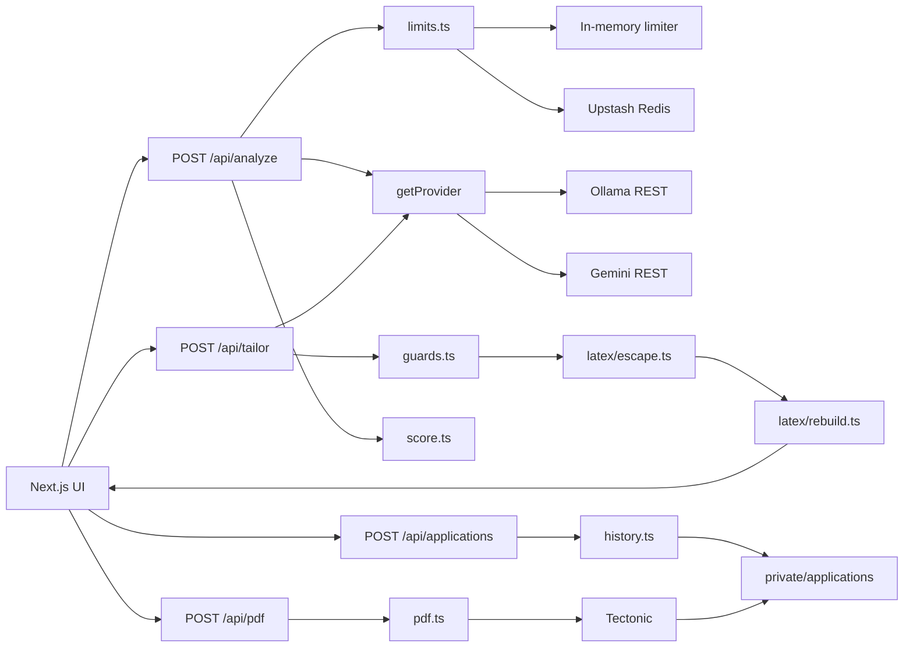

# Resume Tailor

Resume Tailor rewrites LaTeX resume bullets for a specific job description without inventing facts. It shows present and missing keywords, scores the resume before and after, lets you accept or reject each rewrite, and exports the tailored `.tex` file. In personal mode it can save applications and compile PDFs locally with Tectonic.

## Personal vs demo mode

| Feature | Personal | Demo |
| --- | --- | --- |
| Resume source | Uploaded/pasted text, `private/base.tex`, then sample | Uploaded/pasted text or sample |
| LLM provider | Ollama by default | Gemini by default |
| Data handling | Stays local unless you choose another provider | Text is sent to the Gemini API |
| Saved resume | Available via `/api/base` | Disabled with 404 |
| Application history | Available under `private/applications/` | Disabled with 404 |
| PDF export | Available when Tectonic is installed | Disabled with 404 |
| Limits | None | Size, bullet, hourly, and daily caps |
| Search indexing | Normal | `noindex, nofollow` |

## Setup

Install Ollama for your operating system, then start it and pull the default model:

```bash
ollama serve
ollama pull qwen3:4b
```

Copy the example environment file:

```bash
cp .env.example .env.local
```

Put your resume at `private/base.tex`. The directory is gitignored.

Run the app:

```bash
npm install
npm run dev
```

Open `http://localhost:3000`.

## Run locally with Ollama

Use these values in `.env.local`:

```bash
APP_MODE=personal
LLM_PROVIDER=ollama
OLLAMA_BASE_URL=http://localhost:11434
OLLAMA_MODEL=qwen3:4b
```

The app calls the local Ollama API, validates every JSON response with Zod, and retries once on invalid output. It rewrites one bullet at a time with a low-temperature prompt. If Ollama is unreachable or the model is missing, the UI shows a clear error from `/api/health`.

The tailoring flow is:

1. Paste or upload a `.tex` resume and a job description.
2. Review extracted requirements and the before score.
3. Accept or reject each proposed bullet rewrite.
4. Download `resume.tailored.tex`.
5. Optionally save the application and compile a PDF.

PDF export requires Tectonic on your `PATH`. The app only runs `tectonic -X compile resume.tailored.tex` inside the saved application folder. If the compiled PDF has more pages than `private/base.tex`, the UI warns you.

## Public demo

Deploy with `APP_MODE=demo` or on Vercel, where `VERCEL` is set automatically. The provider defaults to Gemini unless `LLM_PROVIDER=ollama` is set explicitly.

Set these server-side variables:

```bash
GEMINI_API_KEY=your-gemini-api-key
GEMINI_MODEL=your-gemini-model
UPSTASH_REDIS_REST_URL=your-upstash-redis-rest-url
UPSTASH_REDIS_REST_TOKEN=your-upstash-redis-rest-token
DAILY_LLM_CAP=500
```

Demo mode sends resume and job text to Google's Gemini API to generate suggestions. Nothing is stored by this app. If Upstash is missing, an in-memory per-IP limiter is used. Demo limits are 30,000 resume characters, 10,000 JD characters, 40 bullets, 60 bullet requests per IP per hour, and a daily cap. Requests return `413` or `429` with clear messages.

Personal-only endpoints return `404` in demo mode, and the UI hides the saved resume, history, and PDF controls. Demo logs only status codes and timings.

## Architecture



## Anti-invention approach

The model never edits the LaTeX document directly. It extracts structured job requirements and proposes one bullet rewrite at a time. Application code decides which keywords are present, which are missing, and how the score changes.

Every proposal is checked before display. A rewrite is rejected if it adds a number or percentage not in the original, introduces a tech term absent from the full resume, changes length by more than 15 percent, contains LaTeX commands or newlines, is empty, or is identical to the original. On rejection the model gets the exact reasons once; if the second attempt still fails, the original bullet is kept. Output is escaped before insertion so model text cannot break LaTeX.

## Verification

```bash
npm run check
npm run build
```
